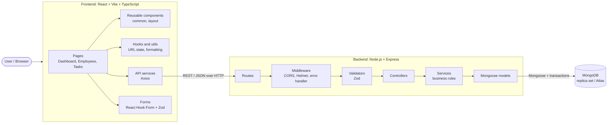
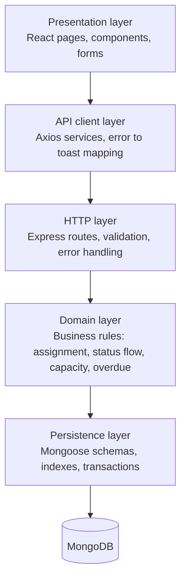
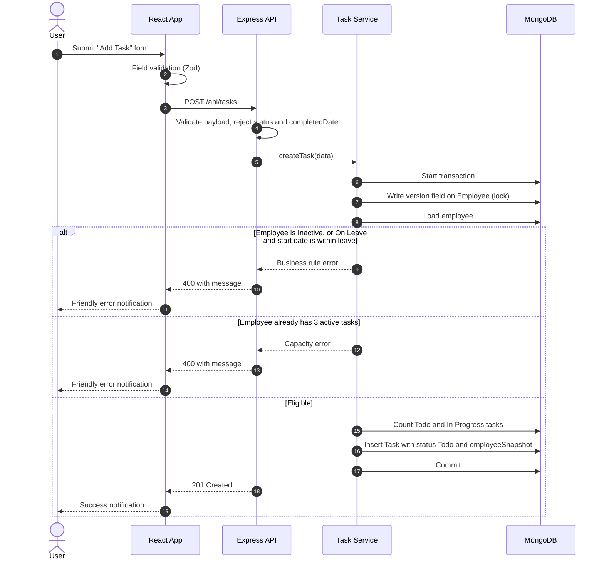
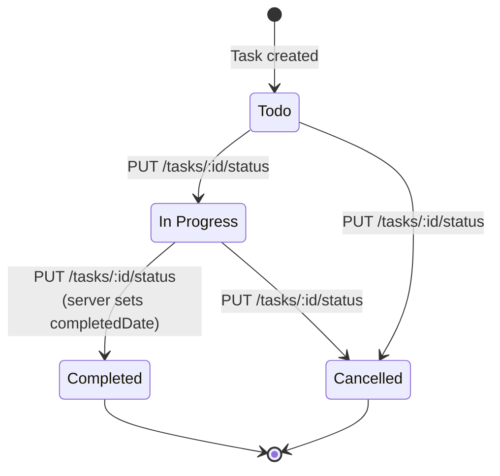
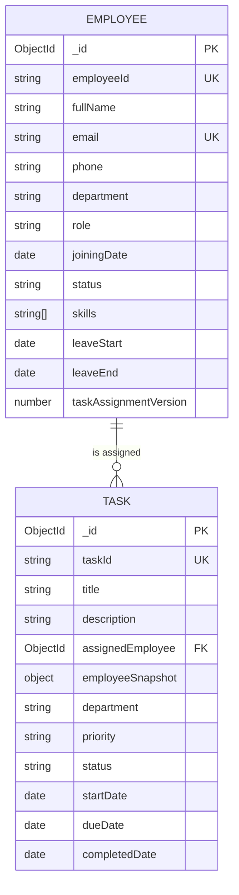

# Roots Media Marketing: Employee & Task Management System

A full-stack **MERN** application (MongoDB, Express, React, Node.js) built for the Roots Media Marketing MERN Stack Developer Intern assignment. Companies can manage employees, assign tasks to them, and monitor progress on a dashboard. The main focus is **backend-enforced business rules**: assignment eligibility, status flow, capacity limits, overdue logic and safe employee deletion.

| | |
| --- | --- |
| **Frontend (live)** | `<add deployed frontend URL>` |
| **Backend (live)** | `<add deployed backend URL>` |
| **Repository** | `<add Git repository URL>` |
| **Author** | `<FirstName LastName>` |

---

## Table of contents

1. [Features](#features)
2. [Technology stack](#technology-stack)
3. [High-level architecture](#high-level-architecture)
4. [Project structure](#project-structure)
5. [Getting started](#getting-started)
6. [Environment variables](#environment-variables)
7. [Data model and Employee → Task relationship](#data-model-and-employee--task-relationship)
8. [Business rules](#business-rules)
9. [API overview](#api-overview)
10. [Frontend routes and URL-driven state](#frontend-routes-and-url-driven-state)
11. [Testing](#testing)
12. [Troubleshooting](#troubleshooting)
13. [Design decisions (assignment Q&A)](#design-decisions-assignment-qa)
14. [Assumptions](#assumptions)
15. [Implementation status](#implementation-status)

---

## Features

- **Employee management**: create, view, edit and delete employees with search, filters, sorting and server-side pagination.
- **Task management**: create, view and edit tasks, with a server-owned status workflow.
- **Business rules on the backend**: Active-only assignment, leave-period checks, date validation, status transitions, 3-active-task capacity and delete protection.
- **Overdue tracking**: one shared helper keeps overdue results consistent across list, details, dashboard and CSV.
- **Dashboard and Analytics**: employee and task counts, completion rate and recent tasks.
- **Server-side search, filters and sorting**: title, employee name, department, priority, status and due-date range, all combinable.
- **CSV export**: exports every task matching the current filters, not just the visible page.
- **URL-synchronized views**: search, filters, sorting and page number live in the URL, so refreshing or sharing a link restores the same view.
- **Responsive UI**: works on mobile, tablet and desktop, with loading states and friendly toast notifications.
- **Transaction-safe concurrency**: concurrent assignments cannot push an employee above the capacity limit.

---

## Technology stack

| Layer | Technologies |
| --- | --- |
| **Frontend** | React, Vite, TypeScript, Tailwind CSS 4, React Router, Axios, Lucide React, React Hook Form, Zod, React Hot Toast |
| **Backend** | Node.js, Express, MongoDB, Mongoose, dotenv, CORS, Helmet, Zod |
| **Tooling** | Nodemon, Vitest, Supertest, ESLint, Prettier, concurrently |

---

## High-level architecture

### System overview



### Layered responsibility



The frontend validates input for fast user feedback, but **the backend is the source of truth** for every business rule.

### Task assignment flow



### Task status lifecycle



### Entity relationship



---

## Project structure

```text
client/
  public/
  src/
    assets/
    components/
      common/          # Reusable UI building blocks
      layout/          # Header, sidebar, shell
    layouts/
    pages/             # Dashboard, Employee and Task screens
    routes/
    services/          # Axios API clients
    hooks/
    utils/
    types/
    App.tsx
    index.css
    main.tsx
  .env.example
  eslint.config.js
  package.json
  tsconfig*.json
  vite.config.ts
server/
  src/
    config/            # Environment and database connection
    controllers/       # HTTP request handlers
    middleware/        # Error handling, 404, validation
    models/            # Mongoose schemas
    routes/
    services/          # Business logic
    validators/        # Zod request schemas
    utils/             # Shared helpers, e.g. isTaskOverdue
    app.js
    server.js
  tests/
    employeeApi.test.js
    employeeValidators.test.js
    health.test.js
    taskApi.test.js
    taskQuery.test.js
    taskValidators.test.js
  .env.example
  package.json
.editorconfig
.gitignore
.prettierrc.json
package.json
```

---

## Getting started

### Prerequisites

- **Node.js** 20.19+ (or 22.12+). The project was set up with Node.js 24.16.0.
- **npm**
- **MongoDB**: a local server or a MongoDB Atlas URI. It must be **transaction-capable** (replica set or Atlas), see [Business rules](#business-rules). This project does not install or start MongoDB for you.

### 1. Install dependencies

From the project root:

```bash
npm install
npm --prefix client install
npm --prefix server install
```

### 2. Configure environment files

```bash
# Windows
copy server\.env.example server\.env
copy client\.env.example client\.env

# macOS / Linux
cp server/.env.example server/.env
cp client/.env.example client/.env
```

Then set `MONGODB_URI` in `server/.env`. Real `.env` files are ignored by Git.

### 3. Start MongoDB

- **Local:** install MongoDB Community Server, run it as a replica set so transactions work, and use a URI such as `mongodb://127.0.0.1:27017`.
- **Atlas:** create a cluster, allow your IP in Network Access, and paste the connection string into `MONGODB_URI`. Never commit or share it.

### 4. Run the apps

```bash
npm run dev            # client and server together
npm run dev:client     # frontend only
npm run dev:server     # backend only
```

| Service | URL |
| --- | --- |
| Frontend | <http://localhost:5173> |
| Backend health check | <http://localhost:5000/api/health> |

The health check returns **200** with `"database": "connected"` only when Mongoose is connected. Otherwise it returns **503** with `"database": "disconnected"`.

### Build

```bash
npm run build
```

---

## Environment variables

Examples are in `server/.env.example` and `client/.env.example`.

| Variable | Location | Purpose |
| --- | --- | --- |
| `MONGODB_URI` | `server/.env` | MongoDB connection string |
| `PORT` | `server/.env` | API port (default `5000`) |
| `CLIENT_URL` | `server/.env` | Allowed CORS origin; must match the frontend origin exactly (default `http://localhost:5173`) |
| `MONGODB_TEST_URI` | `server/.env` | Disposable database for integration tests (name must end in `_test`) |
| `VITE_API_BASE_URL` | `client/.env` | Backend API base URL |

> `VITE_API_BASE_URL` is the only client-side setting. Credentials and other secrets must stay in `server/.env` and must never use the `VITE_` prefix.

---

## Data model and Employee → Task relationship

### Employee

| Field | Type | Rules |
| --- | --- | --- |
| `employeeId` | String | Required, trimmed, **unique** |
| `fullName` | String | Required, trimmed |
| `email` | String | Required, trimmed, lowercased, **unique** |
| `phone` | String | Required Indian mobile number, stored as `+91` followed by 10 digits |
| `department` | String | `Development`, `Design`, `QA`, `HR` or `Sales` |
| `role` | String | Required |
| `joiningDate` | Date | Required |
| `status` | String | `Active`, `Inactive` or `On Leave`; defaults to `Active` |
| `skills` | String[] | Optional; defaults to `[]` |
| `leaveStart`, `leaveEnd` | Date | Required together when `On Leave`; end cannot precede start; cleared when status changes away from `On Leave` |
| `taskAssignmentVersion` | Number | Internal concurrency token, not a workload counter |
| `createdAt`, `updatedAt` | Date | Mongoose timestamps |

- Email is lowercased and trimmed before saving.
- MongoDB unique indexes enforce `employeeId` and `email`, including under concurrent requests.
- Phone accepts 10 digits starting with 6-9, optionally prefixed with `+91`. Spaces and hyphens are allowed as separators.

### Task

| Field | Type | Rules |
| --- | --- | --- |
| `taskId` | String | Auto-generated UUID |
| `title` | String | Required |
| `description` | String | Optional |
| `assignedEmployee` | ObjectId | Reference to `Employee` |
| `employeeSnapshot` | Object | `employeeId`, `fullName`, `department` captured for history |
| `department` | String | Department enum |
| `priority` | String | `Low`, `Medium`, `High` or `Critical` |
| `status` | String | `Todo`, `In Progress`, `Completed` or `Cancelled`; starts as `Todo` |
| `startDate`, `dueDate` | Date | Date-only `YYYY-MM-DD`, normalized to midnight UTC; due date cannot precede start date |
| `completedDate` | Date | Set by the server when the task becomes `Completed` |
| `createdAt`, `updatedAt` | Date | Mongoose timestamps |

### Relationship

```text
Employee (1) ───────< (many) Task
```

- Each task references one employee through `assignedEmployee`, an ObjectId.
- Each task also stores an `employeeSnapshot` (ID, name, department), so history stays readable after the employee is gone.

### How employee deletion is handled

1. An employee **cannot be deleted** while they have `Todo` or `In Progress` tasks. The API returns **400**.
2. Deletion takes the same per-employee lock used by assignment, so no task can be assigned during deletion.
3. Any missing historical snapshots are filled in, and the employee is deleted in the same transaction.
4. Tasks are **retained, never cascade-deleted**. They keep their snapshot, so list, details and CSV still show who the task belonged to.

---

## Business rules

All of the following are enforced on the **backend**. The frontend only mirrors them for usability.

| Rule | Behaviour |
| --- | --- |
| **Assignment** | Only `Active` employees can receive tasks. `Inactive` is always rejected. `On Leave` is rejected only when the task's start date falls inside the leave period (both dates inclusive). |
| **Dates** | Due date cannot be earlier than start date. |
| **Status flow** | `Todo → In Progress → Completed`; `Todo / In Progress → Cancelled`. Anything else, including same-status updates, is rejected. |
| **Status endpoint only** | New tasks always start as `Todo`. Status changes only via `PUT /api/tasks/:id/status`. Creation and regular edits reject `status` and `completedDate`. |
| **Terminal tasks** | `Completed` and `Cancelled` tasks cannot be edited. |
| **Completed date** | Assigned by the server clock, never taken from the client. |
| **Capacity** | An employee can hold at most **3** active tasks (`Todo` + `In Progress`). |
| **Overdue** | Today (UTC calendar day) is later than the due date and status is neither `Completed` nor `Cancelled`. A single shared `isTaskOverdue(task, now)` helper is used everywhere. |
| **Delete employee** | Blocked while the employee has active tasks; historical tasks keep their snapshot. |

### Transaction requirement

Assignment, reassignment and deletion use MongoDB transactions, so they require a **transaction-capable deployment** (replica set or Atlas). On a standalone MongoDB instance these endpoints return **503** with setup guidance. The API never silently falls back to unsafe count-then-write checks.

---

## API overview

Base URL: `http://localhost:5000/api`

### Dashboard

| Method | Endpoint | Description |
| --- | --- | --- |
| `GET` | `/dashboard` | Server-calculated employee/task counts, completion rate, employee workload, and deadline lists |
`GET /api/dashboard` returns employee and task counts, completion rate, overdue count, active-task workload per employee, up to five recently created tasks, and up to five upcoming and recently due deadlines. Workload and deadlines are calculated server-side from the full task collection.

Analytics displays team/task metrics, task status and priority doughnut charts, and task counts by department. Workload, recent tasks, and deadlines are shown on the Dashboard only.

### Health

| Method | Endpoint | Description |
| --- | --- | --- |
| `GET` | `/health` | API and database status |

### Employees

| Method | Endpoint | Description |
| --- | --- | --- |
| `GET` | `/employees` | Search, filter, sort and paginate |
| `POST` | `/employees` | Create an employee |
| `GET` | `/employees/:employeeId` | Get by MongoDB ObjectId |
| `PUT` | `/employees/:employeeId` | Update allowed fields |
| `DELETE` | `/employees/:employeeId` | Delete (blocked with active tasks) |

**List query parameters**

| Parameter | Description |
| --- | --- |
| `search` | Case-insensitive match on employee ID, full name or email |
| `department` | Department filter |
| `status` | `Active`, `Inactive` or `On Leave` |
| `page` | 1-based, default `1` |
| `limit` | 1-100, default `10` |
| `sortBy` | `fullName`, `employeeId`, `joiningDate`, `createdAt` or `department` (default `createdAt`) |
| `order` | `asc` or `desc` (default `desc`) |

<details>
<summary>Example: create employee</summary>

```json
{
  "employeeId": "EMP-1001",
  "fullName": "Rohit Sharma",
  "email": "rohit@example.com",
  "phone": "+91 98765-43210",
  "department": "Development",
  "role": "Developer",
  "joiningDate": "2024-01-15",
  "skills": ["React", "Node.js"]
}
```

Response: **201 Created**

```json
{
  "success": true,
  "message": "Employee created successfully",
  "data": {
    "_id": "MongoDB-generated ObjectId",
    "employeeId": "EMP-1001",
    "fullName": "Rohit Sharma",
    "email": "rohit@example.com",
    "phone": "+919876543210",
    "department": "Development",
    "role": "Developer",
    "status": "Active",
    "skills": []
  }
}
```

</details>

### Tasks

Task routes use the MongoDB `_id` as `:taskId`. The generated business identifier is returned as `data.taskId`.

| Method | Endpoint | Description |
| --- | --- | --- |
| `GET` | `/tasks` | Search, filter, sort and paginate |
| `POST` | `/tasks` | Create a task |
| `GET` | `/tasks/:taskId` | Get by MongoDB ObjectId |
| `PUT` | `/tasks/:taskId` | Edit allowed fields (not status or completed date) |
| `PUT` | `/tasks/:taskId/status` | Apply a valid status transition |
| `GET` | `/tasks/export/csv` | Export all tasks matching the active search, filters and sort |

**List query parameters**

| Parameter | Description |
| --- | --- |
| `search` | Case-insensitive match on task title or assigned employee name (including historical snapshots) |
| `department` | Department filter |
| `priority` | `Low`, `Medium`, `High` or `Critical` |
| `status` | `Todo`, `In Progress`, `Completed` or `Cancelled` |
| `dueDateFrom`, `dueDateTo` | Inclusive UTC date-only due-date range (legacy `dueFrom` / `dueTo` still accepted) |
| `page`, `limit` | 1-based page; limit 1-100 |
| `sortBy` | `createdAt`, `dueDate`, `priority` or `title` |
| `sortOrder` | `asc` or `desc` (legacy `order` still accepted) |

- Priority order is explicit: `Critical > High > Medium > Low`.
- Default sort is `createdAt` descending, with `_id` as a stable tie-breaker.
- CSV text is escaped and spreadsheet formula prefixes are neutralized.

<details>
<summary>Example: create task</summary>

```json
{
  "title": "Prepare payment report",
  "description": "Reconcile the monthly payment data",
  "assignedEmployee": "68f000000000000000000001",
  "department": "Development",
  "priority": "High",
  "startDate": "2026-11-10",
  "dueDate": "2026-11-20"
}
```

Response: **201 Created** with `status: "Todo"`.

</details>

### Response format

**Paginated list**

```json
{
  "success": true,
  "data": [],
  "pagination": { "currentPage": 1, "pageSize": 10, "totalItems": 0, "totalPages": 0 }
}
```

A page beyond the last returns an empty `data` array and keeps the requested `currentPage`.

**Error**

```json
{
  "success": false,
  "message": "Request validation failed",
  "errors": [{ "field": "email", "message": "Invalid email address" }]
}
```

### HTTP status codes

| Code | Meaning |
| --- | --- |
| `200` | Successful read, update or delete |
| `201` | Resource created |
| `400` | Invalid data, invalid ID or broken business rule |
| `404` | Resource or route not found |
| `409` | Duplicate employee ID or email |
| `500` | Unexpected error (details are not exposed to clients) |
| `503` | Database unavailable, or MongoDB deployment does not support transactions |

---

## Frontend routes and URL-driven state

| Area | Screens |
| --- | --- |
| **Dashboard** | Dashboard, Analytics |
| **Employees** | List, Add, Edit, View details |
| **Tasks** | List, Add, Edit, View details |

Search, filters, sorting and page number are stored in the query string, for example:

```text
/tasks?status=In%20Progress&priority=High&page=2
```

## Assignment behavior and design answers

1. Status changes are validated by the backend service against the allowed task transition graph.
2. The backend sets `completedDate` when a task enters `Completed`; clients cannot set it.
3. Inactive employees cannot be assigned tasks. Assignments starting during an employee's inclusive leave period are rejected.
4. Search, filters, sorting, and pagination are applied on the server.
5. Task list search, filters, sort order, and page are retained in the URL.
6. MongoDB transactions serialize assignments and deletion against the three-active-task limit; use a replica set or Atlas.

## Tests and database requirements

Run `npm test` for backend tests. Employee, task, and dashboard API integration tests use `MONGODB_TEST_URI` (default `mongodb://127.0.0.1:27017/roots_management_test`) and a disposable test database. Employee and task mutation integration tests require a transaction-capable MongoDB deployment. If MongoDB is unavailable or transactions are unsupported, database-backed tests are skipped; run them against a replica set or Atlas before submission.

UI notes:

- The status dropdown shows only the **valid next statuses**.
- Server error messages appear as friendly toast notifications.
- `Completed` and `Cancelled` tasks are read-only in the UI.
- Export CSV downloads **all** tasks matching the current filters.
- The header notification bell lists overdue tasks, tasks due within seven days and employees on leave. Read and dismissed state is kept in memory and resets on reload.
- Add/Edit forms have a sample autofill button for demos. It only fills the form and saves nothing until submitted.

---

## Testing

```bash
npm test                          # server tests
npm --prefix client run lint      # frontend lint
npm run build                     # production build
```

- Integration tests use `MONGODB_TEST_URI` (default `mongodb://127.0.0.1:27017/roots_management_test`) and only clean up records they create. Use a disposable database ending in `_test`, on a transaction-capable deployment.
- If MongoDB is unavailable or does not support transactions, the database integration tests are **skipped with a warning**.
- Schema, validator, route-validation, health and overdue-helper tests run without MongoDB.

Latest verification in this workspace: `npm test` reported **32 passed** and **38 database integration tests skipped** because MongoDB was not available. `npm run build`, `npm --prefix client run lint` and server syntax checks passed. Run the database-backed tests against a transaction-capable deployment before relying on runtime behavior.

---

## Troubleshooting

| Problem | Fix |
| --- | --- |
| Port 5173 is occupied | Stop the process using it. Vite is configured to fail rather than pick another port. |
| Port 5000 is occupied | Stop the conflicting process, or set another `PORT` in `server/.env`. |
| MongoDB connection refused | Confirm the service is running and check `MONGODB_URI`. |
| Atlas connection fails | Check the URI, credentials, cluster status and Network Access settings. |
| CORS errors | Make `CLIENT_URL` in `server/.env` match the frontend origin exactly. |
| `503` on task create or employee delete | Your MongoDB is standalone. Use a replica set or Atlas. |
| Missing environment file | Copy each `.env.example` to `.env`. |

---

## Design decisions (assignment Q&A)

**1. Where do you validate status transitions, and why?**
On the **backend**, in the task status flow behind `PUT /api/tasks/:id/status`, using an explicit allowed-transition map. The frontend can be bypassed (Postman, edited requests, stale tabs), so the server must be the source of truth. The UI mirrors the rules only by showing valid next statuses. The regular edit endpoint rejects `status`, so there is one controlled path for status changes.

**2. Why does Completed Date come from the backend?**
A client-supplied date can be wrong, forged or affected by the user's timezone or clock. Setting it from the server clock at the moment of the transition gives a trustworthy, consistent audit value, and it cannot be set at all unless the task actually reaches `Completed`.

**3. How do you block Inactive / On Leave assignment?**
On create and reassignment, the server loads the employee and checks eligibility. `Inactive` employees are always rejected. `On Leave` employees are rejected only when the task's start date falls between `leaveStart` and `leaveEnd` inclusive, compared on UTC calendar days. Anything else returns a **400** with a readable message, which the form shows to the user.

**4. Why are filtering and pagination on the backend?**
Loading every record and filtering in React does not scale: it wastes bandwidth and memory, and slows the UI as data grows. Server-side queries return only the requested page, keep sorting and counts accurate, and let the CSV export reuse the exact same filter logic across all matching rows.

**5. Why do filters live in the URL?**
The URL becomes the single source of truth for the view. Refreshing, using the back/forward buttons, or sharing a link restores the same search, filters, sort and page. It also makes views bookmarkable and easy to debug.

**6. What can go wrong if two requests assign a 4th active task at the same time?**
Both requests could read "2 active tasks" before either writes, both pass the capacity check, and the employee ends up with **4 active tasks**, a classic check-then-write race. This project prevents it by serializing assignments per employee: each request writes the employee's version field inside a MongoDB transaction, so concurrent requests cannot both proceed. Then the active tasks are counted and the task is written in the same transaction. Employee deletion uses the same lock.

---

## Assumptions

- No login or authentication is required.
- Departments are fixed: Development, Design, QA, HR, Sales.
- Dates are date-only (`YYYY-MM-DD`) and compared as UTC calendar days.
- Phone numbers are Indian mobile numbers.
- Reassigning a task to another employee re-runs eligibility and capacity checks.
- Deleted employees remain visible on historical tasks through the stored snapshot.
- The notification bell is an in-memory convenience, not a persisted or push feed.
- No AI integrations are included.

---

## Implementation status

| Phase | Scope | Status |
| --- | --- | --- |
| 1 | Project setup, frontend shell, backend config, MongoDB lifecycle, health endpoint | Complete |
| 2 | Employee model and CRUD APIs, validation, search/filter/sort/pagination, centralized errors | Complete |
| 3 | Task APIs, eligibility and leave checks, capacity, transactions, status transitions, delete protection, snapshots, overdue helper | Implemented |
| 4 | Responsive shell, Dashboard, Employee List and Task List screens | Complete |
| 5 | Employee List, Add, Details and Edit routes with full API integration | Complete |
| 6 | Task List, Add, Details and Edit routes, status transitions, overdue data | Complete |
| 7 | Task search/filters/sorting, URL state restoration, CSV export | Complete |
| Extras | Analytics page, notification bell, sample autofill buttons | Complete |

**Dashboard and analytics:** Dashboard displays employee workload, recent tasks, upcoming deadlines, and recently due tasks. Analytics displays aggregate metrics and charts. Notifications include overdue tasks, tasks due within seven days, and employees on leave; read/dismissed state resets on page reload. Employee and task forms include a sample autofill action; values are not saved until submitted.

No authentication or AI integrations are included.
