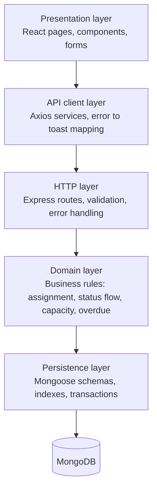
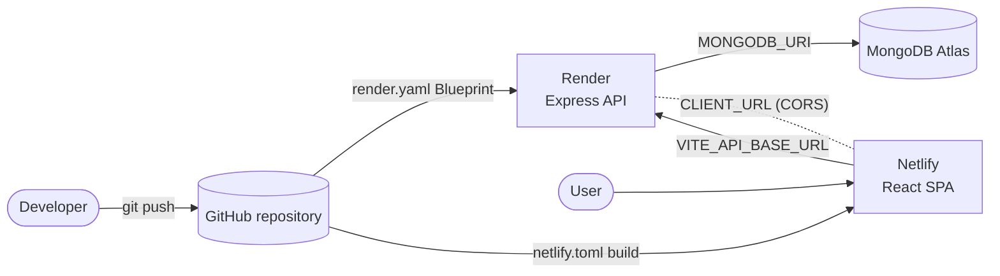
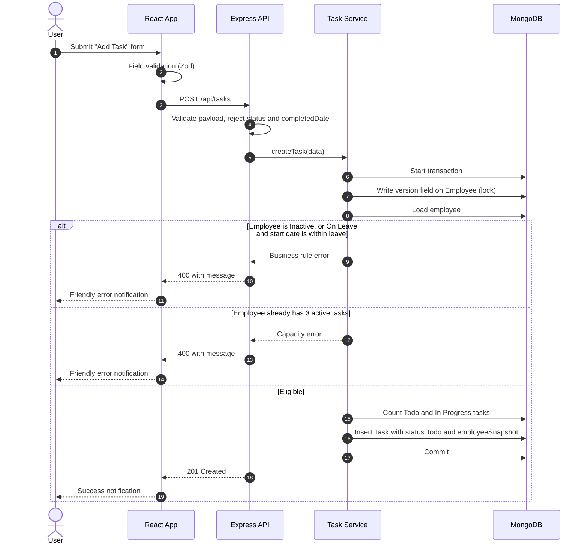
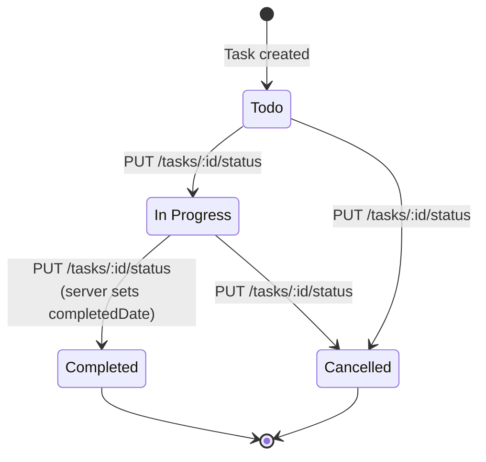
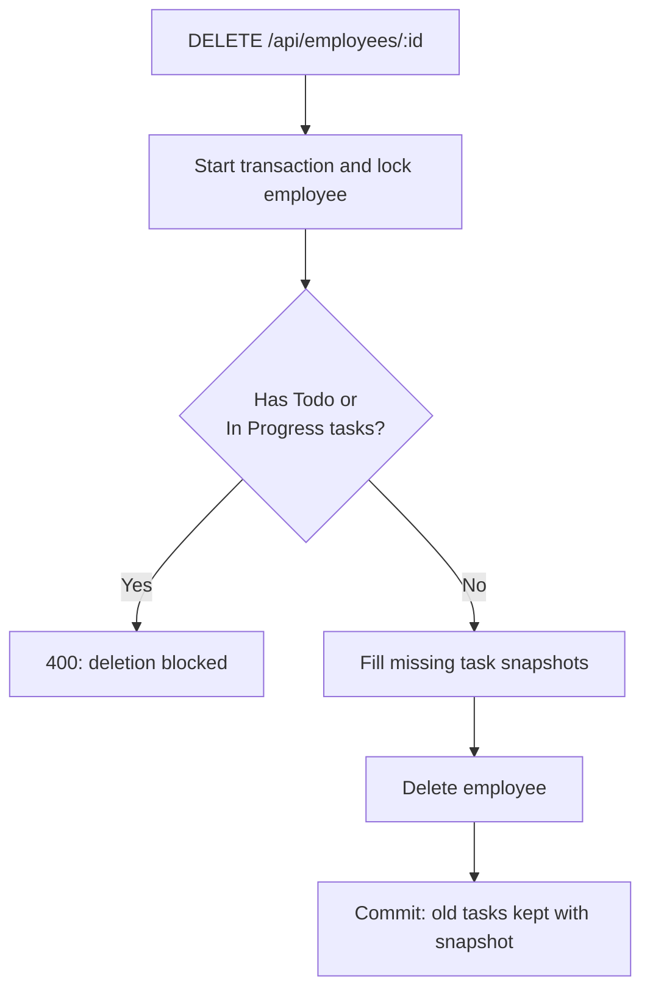
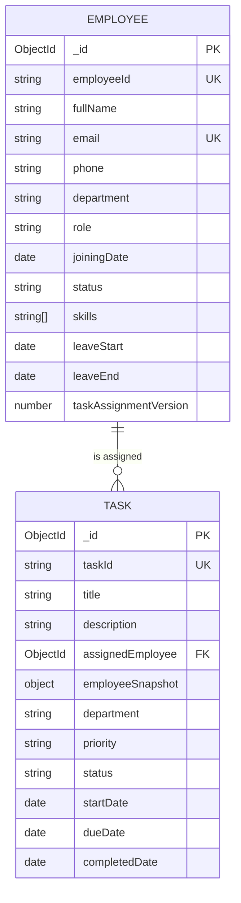

# Roots Media Marketing: Employee & Task Management System

A full-stack **MERN** app (MongoDB, Express, React, Node.js) built for the Roots Media Marketing MERN Stack Developer Intern assignment.

- Manage employees.
- Assign tasks to them.
- Track progress on a dashboard.
- All business rules are enforced on the **backend**.

| | |
| --- | --- |
| **Frontend** | Not deployed yet |
| **Backend** | Not deployed yet |
| **Repository** | <https://github.com/rohi5431/Root_MERN_Assignment> |
| **Author** | Not specified |

---

## Table of contents

1. [Features](#features)
2. [Technology stack](#technology-stack)
3. [Architecture diagrams](#architecture-diagrams)
4. [Project structure](#project-structure)
5. [Getting started](#getting-started)
6. [Environment variables](#environment-variables)
7. [Deployment](#deployment)
8. [Data model](#data-model)
9. [Business rules](#business-rules)
10. [API overview](#api-overview)
11. [Frontend routes and URL state](#frontend-routes-and-url-state)
12. [Testing](#testing)
13. [Troubleshooting](#troubleshooting)
14. [Design decisions (assignment Q&A)](#design-decisions-assignment-qa)
15. [Assumptions](#assumptions)
16. [Implementation status](#implementation-status)

---

## Features

**Employees**
- Create, view, edit and delete employees.
- Search, filter by department and status, sort, and paginate.

**Tasks**
- Create, view and edit tasks.
- Status changes only through a dedicated status API.
- Search, filter, sort, and paginate on the server.
- Export all matching tasks to CSV (not only the visible page).

**Dashboard and Analytics**
- Employee and task counts, completion rate, overdue count.
- Employee workload (active tasks per employee).
- Recent tasks, upcoming and recently due deadlines.
- Charts for status, priority and tasks per department.

**Quality**
- Backend-enforced business rules.
- Transaction-safe assignment (no 4th active task, even with parallel requests).
- Filters and page number stay in the URL.
- Responsive on mobile, tablet and desktop.
- Loading states and friendly toast messages.

---

## Technology stack

| Layer | Technologies |
| --- | --- |
| **Frontend** | React, Vite, TypeScript, Tailwind CSS 4, React Router, Axios, Lucide React, React Hook Form, Zod, React Hot Toast |
| **Backend** | Node.js, Express, MongoDB, Mongoose, dotenv, CORS, Helmet, Zod |
| **Tooling** | Nodemon, Vitest, Supertest, ESLint, Prettier, concurrently |
| **Hosting** | Netlify (frontend), Render (API), MongoDB Atlas (database) |

---

## Architecture diagrams

### 1. System overview


### 2. Layers and responsibilities



- The frontend validates for quick feedback.
- **The backend is the source of truth** for every rule.

### 3. Deployment



### 4. Task assignment flow



### 5. Task status lifecycle



### 6. Employee deletion flow



### 7. Entity relationship



---

## Project structure

```text
Root_MERN_Assignment/
│
├── client/                          # Frontend (React + Vite + TypeScript)
│   ├── public/                      # Static files
│   ├── src/
│   │   ├── assets/                  # Images and static assets
│   │   ├── components/
│   │   │   ├── common/              # Reusable UI building blocks
│   │   │   └── layout/              # Header, sidebar, app shell
│   │   ├── layouts/                 # Page layouts
│   │   ├── pages/                   # Dashboard, Analytics, Employee and Task screens
│   │   ├── routes/                  # React Router setup
│   │   ├── services/                # Axios API clients
│   │   ├── hooks/                   # Custom hooks (e.g. URL state)
│   │   ├── utils/                   # Helpers (formatting, etc.)
│   │   ├── types/                   # TypeScript types
│   │   ├── App.tsx
│   │   ├── index.css
│   │   └── main.tsx
│   ├── .env.example                 # Frontend env template
│   ├── eslint.config.js
│   ├── package.json
│   ├── tsconfig*.json
│   └── vite.config.ts
│
├── server/                          # Backend (Node.js + Express + Mongoose)
│   ├── src/
│   │   ├── config/                  # Environment and database connection
│   │   ├── controllers/             # HTTP request handlers
│   │   ├── middleware/              # Error handling, 404, validation
│   │   ├── models/                  # Mongoose schemas
│   │   ├── routes/                  # API route definitions
│   │   ├── services/                # Business logic and rules
│   │   ├── validators/              # Zod request schemas
│   │   ├── utils/                   # Shared helpers (e.g. isTaskOverdue)
│   │   ├── app.js                   # Express app setup
│   │   └── server.js                # Server entry point
│   ├── tests/
│   │   ├── employeeApi.test.js
│   │   ├── employeeValidators.test.js
│   │   ├── health.test.js
│   │   ├── taskApi.test.js
│   │   ├── taskQuery.test.js
│   │   └── taskValidators.test.js   # (dashboard API tests are also included)
│   ├── .env.example                 # Backend env template
│   └── package.json
│
├── render.yaml                      # Render Blueprint (API deployment)
├── netlify.toml                     # Netlify config (frontend deployment)
├── package.json                     # Root scripts (dev, build, test)
├── .editorconfig
├── .gitignore
├── .prettierrc.json
└── README.md
```

---

## Getting started

### Prerequisites

- **Node.js** 20.19+ (or 22.12+). Set up with Node.js 24.16.0.
- **npm**
- **MongoDB**: local server or Atlas URI.
  - Must support **transactions** (replica set or Atlas).
  - This project does not install or start MongoDB for you.

### Steps

**1. Install dependencies** (from the project root)

```bash
npm install
npm --prefix client install
npm --prefix server install
```

**2. Create environment files**

```bash
# Windows
copy server\.env.example server\.env
copy client\.env.example client\.env

# macOS / Linux
cp server/.env.example server/.env
cp client/.env.example client/.env
```

- Set `MONGODB_URI` in `server/.env`.
- Real `.env` files are ignored by Git.

**3. Start MongoDB**

- **Local:** install MongoDB Community Server and run it as a replica set (example URI: `mongodb://127.0.0.1:27017`).
- **Atlas:** create a cluster, allow your IP in Network Access, paste the connection string into `MONGODB_URI`. Never commit it.

**4. Run the apps**

```bash
npm run dev            # client and server together
npm run dev:client     # frontend only
npm run dev:server     # backend only
```

| Service | URL |
| --- | --- |
| Frontend | <http://localhost:5173> |
| Backend health check | <http://localhost:5000/api/health> |

- Health returns **200** and `"database": "connected"` when Mongoose is connected.
- Otherwise it returns **503** and `"database": "disconnected"`.

**Production build**

```bash
npm run build
```

---

## Environment variables

Templates: `server/.env.example` and `client/.env.example`.

| Variable | Where | Purpose |
| --- | --- | --- |
| `MONGODB_URI` | `server/.env` | MongoDB connection string |
| `PORT` | `server/.env` | API port (default `5000`) |
| `CLIENT_URL` | `server/.env` | Allowed CORS origin. Must match the frontend origin exactly (default `http://localhost:5173`) |
| `MONGODB_TEST_URI` | `server/.env` | Disposable test database (name must end in `_test`) |
| `VITE_API_BASE_URL` | `client/.env` | Backend API base URL |

- `VITE_API_BASE_URL` is the only client-side setting.
- Secrets stay in `server/.env`. Never use the `VITE_` prefix for them.

---

## Deployment

Files used: [`render.yaml`](./render.yaml) (API) and [`netlify.toml`](./netlify.toml) (frontend). The database must be transaction-capable, such as MongoDB Atlas.

**1. Prepare MongoDB**
- Create an Atlas user with access to the app database only.
- Add the API host's outbound IPs to Atlas Network Access.
- Copy the connection URI and keep it private.

**2. Create the Netlify site**
- Import the repository.
- Note the site URL. It is needed for the API's `CLIENT_URL`.

**3. Deploy the API to Render**
- Create a Blueprint deployment from `render.yaml`.
- Set `MONGODB_URI` (Atlas URI).
- Set `CLIENT_URL` (Netlify origin, with `https://`, no trailing slash).
- Render builds with `npm ci`, starts with `npm start`, and checks `/api/health`.
- Render provides `PORT`. The server listens on all interfaces.

**4. Configure and redeploy the frontend**
- Netlify builds `client/` and publishes `client/dist/`.
- Set the build variable, then trigger a new deploy:

| Variable | Value |
| --- | --- |
| `VITE_API_BASE_URL` | `https://<your-render-api-host>/api` |

- Vite embeds this value at build time, so rebuild after changing it.
- A Netlify rewrite rule makes refresh and direct links on nested routes work.

**5. Verify**
- Open `https://<your-render-api-host>/api/health`. Expect 200 and `"database": "connected"`.
- On the Netlify site, check: create and edit, status changes, filters, CSV export, refresh on a nested route.
- CORS error? Make Render's `CLIENT_URL` match the Netlify origin exactly, then redeploy the API.

> **Note:** The assignment has no authentication. Treat a public deployment as a demo and do not enter real employee data.

---

## Data model

### Employee

| Field | Type | Rules |
| --- | --- | --- |
| `employeeId` | String | Required, trimmed, **unique** |
| `fullName` | String | Required, trimmed |
| `email` | String | Required, trimmed, lowercased, **unique** |
| `phone` | String | Required Indian mobile number, stored as `+91` + 10 digits |
| `department` | String | `Development`, `Design`, `QA`, `HR` or `Sales` |
| `role` | String | Required |
| `joiningDate` | Date | Required |
| `status` | String | `Active`, `Inactive` or `On Leave` (default `Active`) |
| `skills` | String[] | Optional (default `[]`) |
| `leaveStart`, `leaveEnd` | Date | Required together when `On Leave`; end cannot be before start; cleared when status changes away from `On Leave` |
| `taskAssignmentVersion` | Number | Internal lock token, not a workload counter |
| `createdAt`, `updatedAt` | Date | Mongoose timestamps |

Notes:
- Email is trimmed and lowercased before saving.
- Unique indexes enforce `employeeId` and `email`, even with parallel requests.
- Phone: 10 digits starting with 6-9, optional `+91`, spaces and hyphens allowed.

### Task

| Field | Type | Rules |
| --- | --- | --- |
| `taskId` | String | Auto-generated UUID |
| `title` | String | Required |
| `description` | String | Optional |
| `assignedEmployee` | ObjectId | Reference to `Employee` |
| `employeeSnapshot` | Object | `employeeId`, `fullName`, `department` saved for history |
| `department` | String | Department enum |
| `priority` | String | `Low`, `Medium`, `High` or `Critical` |
| `status` | String | `Todo`, `In Progress`, `Completed` or `Cancelled` (starts `Todo`) |
| `startDate`, `dueDate` | Date | `YYYY-MM-DD`, stored as midnight UTC; due date not before start date |
| `completedDate` | Date | Set by the server when the task becomes `Completed` |
| `createdAt`, `updatedAt` | Date | Mongoose timestamps |

### Employee → Task relationship

```text
Employee (1) ───────< (many) Task
```

- A task points to one employee through `assignedEmployee`.
- A task also keeps an `employeeSnapshot` (ID, name, department).
- History stays readable even after the employee is deleted.

### How employee deletion works

- Blocked (**400**) while the employee has `Todo` or `In Progress` tasks.
- Uses the same per-employee lock as assignment.
- Fills any missing snapshots, then deletes the employee in one transaction.
- Tasks are **kept, never cascade-deleted**.
- List, details and CSV still show the old employee details.

---

## Business rules

All rules are enforced on the **backend**. The frontend only mirrors them.

| Rule | What happens |
| --- | --- |
| **Assignment** | Only `Active` employees. `Inactive` is always rejected. `On Leave` is rejected only if the task start date is inside the leave period (both dates inclusive). |
| **Dates** | Due date cannot be earlier than start date. |
| **Status flow** | `Todo → In Progress → Completed` and `Todo / In Progress → Cancelled`. Everything else (including same-status) is rejected. |
| **Status API only** | New tasks start as `Todo`. Status changes only via `PUT /api/tasks/:id/status`. Create and edit reject `status` and `completedDate`. |
| **Terminal tasks** | `Completed` and `Cancelled` tasks cannot be edited. |
| **Completed date** | Set from the server clock, never from the client. |
| **Capacity** | Max **3** active tasks (`Todo` + `In Progress`) per employee. |
| **Overdue** | Today (UTC) is after due date and status is not `Completed` or `Cancelled`. One shared `isTaskOverdue(task, now)` helper is used everywhere. |
| **Delete employee** | Blocked while active tasks exist. Old tasks keep their snapshot. |

**Transaction requirement**
- Assign, reassign and delete use MongoDB transactions.
- Use a replica set or Atlas.
- On standalone MongoDB these endpoints return **503** with setup help.
- The API never falls back to unsafe count-then-write checks.

---

## API overview

Base URL: `http://localhost:5000/api`

### Health

| Method | Endpoint | Description |
| --- | --- | --- |
| `GET` | `/health` | API and database status |

### Dashboard

| Method | Endpoint | Description |
| --- | --- | --- |
| `GET` | `/dashboard` | Server-calculated counts, completion rate, workload and deadlines |

Returns:
- Employee and task counts, completion rate, overdue count.
- Active-task workload per employee.
- Up to 5 recently created tasks.
- Up to 5 upcoming and recently due deadlines.
- Everything is calculated on the server from the full task collection.

### Employees

| Method | Endpoint | Description |
| --- | --- | --- |
| `GET` | `/employees` | Search, filter, sort, paginate |
| `POST` | `/employees` | Create an employee |
| `GET` | `/employees/:employeeId` | Get by MongoDB ObjectId |
| `PUT` | `/employees/:employeeId` | Update allowed fields |
| `DELETE` | `/employees/:employeeId` | Delete (blocked with active tasks) |

**List query parameters**

| Parameter | Description |
| --- | --- |
| `search` | Case-insensitive match on employee ID, name or email |
| `department` | Department filter |
| `status` | `Active`, `Inactive` or `On Leave` |
| `page` | 1-based, default `1` |
| `limit` | 1-100, default `10` |
| `sortBy` | `fullName`, `employeeId`, `joiningDate`, `createdAt` or `department` (default `createdAt`) |
| `order` | `asc` or `desc` (default `desc`) |

<details>
<summary>Example: create employee</summary>

```json
{
  "employeeId": "EMP-1001",
  "fullName": "Rohit Sharma",
  "email": "rohit@example.com",
  "phone": "+91 98765-43210",
  "department": "Development",
  "role": "Developer",
  "joiningDate": "2024-01-15",
  "skills": ["React", "Node.js"]
}
```

Response: **201 Created**

```json
{
  "success": true,
  "message": "Employee created successfully",
  "data": {
    "_id": "MongoDB-generated ObjectId",
    "employeeId": "EMP-1001",
    "fullName": "Rohit Sharma",
    "email": "rohit@example.com",
    "phone": "+919876543210",
    "department": "Development",
    "role": "Developer",
    "status": "Active",
    "skills": []
  }
}
```

</details>

### Tasks

Task routes use the MongoDB `_id` as `:taskId`. The business ID is returned as `data.taskId`.

| Method | Endpoint | Description |
| --- | --- | --- |
| `GET` | `/tasks` | Search, filter, sort, paginate |
| `POST` | `/tasks` | Create a task |
| `GET` | `/tasks/:taskId` | Get by MongoDB ObjectId |
| `PUT` | `/tasks/:taskId` | Edit allowed fields (not status or completed date) |
| `PUT` | `/tasks/:taskId/status` | Apply a valid status change |
| `GET` | `/tasks/export/csv` | Export all tasks matching the search, filters and sort |

**List query parameters**

| Parameter | Description |
| --- | --- |
| `search` | Case-insensitive match on task title or employee name (including saved snapshots) |
| `department` | Department filter |
| `priority` | `Low`, `Medium`, `High` or `Critical` |
| `status` | `Todo`, `In Progress`, `Completed` or `Cancelled` |
| `dueDateFrom`, `dueDateTo` | Inclusive UTC due-date range (old names `dueFrom` / `dueTo` still work) |
| `page`, `limit` | 1-based page; limit 1-100 |
| `sortBy` | `createdAt`, `dueDate`, `priority` or `title` |
| `sortOrder` | `asc` or `desc` (old name `order` still works) |

Sorting and export notes:
- Priority order: `Critical > High > Medium > Low`.
- Default sort: `createdAt` descending, with `_id` as tie-breaker.
- CSV text is escaped and spreadsheet formula prefixes are neutralized.

<details>
<summary>Example: create task</summary>

```json
{
  "title": "Prepare payment report",
  "description": "Reconcile the monthly payment data",
  "assignedEmployee": "68f000000000000000000001",
  "department": "Development",
  "priority": "High",
  "startDate": "2026-11-10",
  "dueDate": "2026-11-20"
}
```

Response: **201 Created** with `status: "Todo"`.

</details>

### Response formats

**Paginated list**

```json
{
  "success": true,
  "data": [],
  "pagination": { "currentPage": 1, "pageSize": 10, "totalItems": 0, "totalPages": 0 }
}
```

- A page past the end returns an empty `data` array and keeps the requested `currentPage`.

**Error**

```json
{
  "success": false,
  "message": "Request validation failed",
  "errors": [{ "field": "email", "message": "Invalid email address" }]
}
```

### HTTP status codes

| Code | Meaning |
| --- | --- |
| `200` | Read, update or delete succeeded |
| `201` | Resource created |
| `400` | Invalid data, invalid ID or broken business rule |
| `404` | Resource or route not found |
| `409` | Duplicate employee ID or email |
| `500` | Unexpected error (details are not sent to clients) |
| `503` | Database unavailable, or MongoDB does not support transactions |

---

## Frontend routes and URL state

| Area | Screens |
| --- | --- |
| **Dashboard** | Dashboard, Analytics |
| **Employees** | List, Add, Edit, View details |
| **Tasks** | List, Add, Edit, View details |

**URL state**
- Search, filters, sort order and page number are stored in the URL.
- Example: `/tasks?status=In%20Progress&priority=High&page=2`
- Refresh or open a copied link to see the same view.

**Dashboard vs Analytics**
- **Dashboard:** employee workload, recent tasks, upcoming deadlines, recently due tasks.
- **Analytics:** aggregate metrics, status and priority doughnut charts, tasks per department.

**UI behavior**
- Status dropdown shows only the **valid next statuses**.
- Server errors appear as friendly toast notifications.
- `Completed` and `Cancelled` tasks are read-only.
- Export CSV downloads **all** tasks matching the current filters.
- Notification bell lists overdue tasks, tasks due within 7 days, and employees on leave.
  - Read and dismissed state is in memory and resets on reload.
- Add/Edit forms have a sample autofill button.
  - It only fills the form. Nothing is saved until you submit.

---

## Testing

```bash
npm test                          # backend tests
npm --prefix client run lint      # frontend lint
npm run build                     # production build
```

- Integration tests (employee, task, dashboard) use `MONGODB_TEST_URI`.
  - Default: `mongodb://127.0.0.1:27017/roots_management_test`.
  - Use a disposable database ending in `_test`.
  - Tests only clean up records they create.
- Mutation tests need a **transaction-capable** MongoDB (replica set or Atlas).
- If MongoDB is missing or unsupported, database tests are **skipped with a warning**.
- Schema, validator, route-validation, health and overdue-helper tests run without MongoDB.

**Latest verification**
- `npm test`: **39 passed**, **40 database tests skipped** (no MongoDB available).
- `npm run build` and `npm --prefix client run lint`: passed.
- Build warning: large chunk, main JS bundle about 565 kB before gzip.
- Run the database tests against a replica set or Atlas before submission.

---

## Troubleshooting

| Problem | Fix |
| --- | --- |
| Port 5173 in use | Stop the process using it. Vite fails instead of picking another port. |
| Port 5000 in use | Stop the other process, or set another `PORT` in `server/.env`. |
| MongoDB connection refused | Check the service is running and `MONGODB_URI` is correct. |
| Atlas connection fails | Check URI, credentials, cluster status and Network Access. |
| CORS errors | Make `CLIENT_URL` match the frontend origin exactly. |
| `503` on task create or employee delete | MongoDB is standalone. Use a replica set or Atlas. |
| Missing environment file | Copy each `.env.example` to `.env`. |
| Frontend calls wrong API after deploy | Fix `VITE_API_BASE_URL` and rebuild the frontend. |

---

## Design decisions (assignment Q&A)

**1. Where do you validate status transitions, and why?**
- In the backend task service, behind `PUT /api/tasks/:id/status`, using an allowed-transition map.
- The frontend can be bypassed (Postman, edited requests, old tabs), so the server decides.
- The UI only shows valid next statuses.
- The normal edit API rejects `status`, so there is one controlled path.

**2. Why does Completed Date come from the backend?**
- Client dates can be wrong, forged, or affected by timezone.
- The server clock gives a trustworthy, consistent value.
- It is set only when the task really becomes `Completed`.

**3. How do you block Inactive / On Leave assignment?**
- On create and reassign, the server loads the employee and checks eligibility.
- `Inactive`: always rejected.
- `On Leave`: rejected only if the start date is between `leaveStart` and `leaveEnd` (inclusive, UTC days).
- Errors return **400** with a clear message shown in the form.

**4. Why are filtering and pagination on the backend?**
- Loading everything and filtering in React is slow and wastes data.
- The server returns only the requested page.
- Counts and sorting stay correct.
- CSV export reuses the same filter logic for all matching rows.

**5. Why do filters live in the URL?**
- The URL is the single source of truth for the view.
- Refresh, back/forward and shared links restore the same view.
- Views can be bookmarked and are easier to debug.

**6. What can go wrong if two requests assign a 4th active task at the same time?**
- Both read "2 active tasks", both pass the check, and the employee ends up with 4 (a check-then-write race).
- Prevented by locking per employee: each request writes the employee's version field inside a MongoDB transaction.
- Parallel requests cannot both continue; the count and task write happen in the same transaction.
- Employee deletion uses the same lock.

---

## Assumptions

- No login or authentication.
- Fixed departments: Development, Design, QA, HR, Sales.
- Dates are date-only (`YYYY-MM-DD`) and compared as UTC days.
- Phone numbers are Indian mobile numbers.
- Reassigning a task re-runs eligibility and capacity checks.
- Deleted employees stay visible on old tasks through the saved snapshot.
- The notification bell is an in-memory convenience, not a persisted or push feed.
- No AI integrations.
